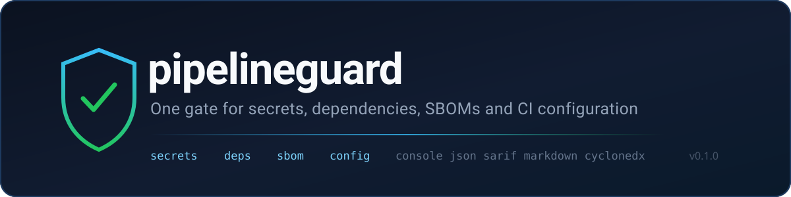

# pipelineguard

[](pyproject.toml)
[](LICENSE)
[](docs/CHECKS.md)

pipelineguard is a CI/CD security gate for repositories. One command scans for
committed secrets, audits dependencies against OSV and a license policy, builds a
CycloneDX 1.5 SBOM and audits Dockerfiles, GitHub Actions workflows and repository
hygiene. A policy turns the findings into a pass or fail verdict with exit codes
that CI can rely on.

It is designed for untrusted code and untrusted input: findings carry redacted
values and fingerprints, never raw credentials; git is invoked without a shell;
network access is limited to the fixed OSV endpoint and can be disabled entirely.

## Features

- **Secret scanning** with 18 rules, entropy checks, placeholder allowlists,
  redaction, staged scanning and git history scanning. Bundled rules cover AWS,
  GitHub, GitLab, Slack, Stripe, Google, npm, PyPI, SendGrid, Twilio, Heroku and
  Azure credentials, private keys, JWTs and generic assignments.
- **Dependency audit** for PyPI, npm, Go and crates.io manifests and lockfiles,
  with OSV severity mapping, fixed versions, aliases and an offline advisory
  database.
- **License compliance** using lockfile license metadata, with a case-insensitive
  SPDX denylist and optional reporting of dependencies whose license is unknown.
- **CycloneDX 1.5 SBOM** with deterministic serial numbers, purls, licenses,
  direct/transitive markers and reproducible component ordering.
- **Configuration audit** for root containers, floating base images, unpinned
  actions, broad workflow permissions, `pull_request_target` checkout risk,
  script injection, echoed secrets, committed `.env` files, missing lockfiles and
  committed private keys.
- **Policy gate** with severity thresholds, required scanners, per-severity
  budgets, path exclusions, expiring allowances and baselines for existing
  findings.
- **Five outputs**: console, JSON, SARIF 2.1.0, Markdown for pull request
  comments and CycloneDX JSON. `--format all` writes four machine artifacts.
- **CI integrations**: composite GitHub Action, reusable workflow and pre-commit
  hooks.

## Requirements

- Python 3.10 or newer
- Git for staged and history scanning (all other modes work on plain directories)
- PyYAML, the only runtime dependency

The package is distributed from this repository:

```console
python -m pip install "pipelineguard @ git+https://github.com/dev-rudran/pipelineguard.git"
# or, with pipx
pipx install "git+https://github.com/dev-rudran/pipelineguard.git"
```

From a checkout:

```console
python3 -m venv .venv
. .venv/bin/activate
python -m pip install -e ".[dev]"
```

## Quick start

Scan the bundled vulnerable example with the offline advisory fixture:

```console
pipelineguard scan examples/vulnerable-repo --offline \
  --advisory-db src/pipelineguard/advisories/osv-fixture.json
```

<details>
<summary>Console output for the vulnerable example</summary>

```console
pipelineguard 0.1.0  target: examples/vulnerable-repo

secrets  (11 finding(s), 0.03s)
  CRITICAL PIPE-SEC-001   .env:2
           AWS access key ID detected. Redacted value: AKIA...HHCU.
           AWS_ACCESS_KEY_ID=AKIA...HHCU
  CRITICAL PIPE-SEC-002   .env:3
           AWS secret access key detected. Redacted value: wJal...Y000.
           AWS_SECRET_ACCESS_KEY=wJal...Y000
  CRITICAL PIPE-SEC-003   .env:4
           GitHub token detected. Redacted value: ghp_...J4R0.
           GITHUB_TOKEN=ghp_...J4R0
  HIGH     PIPE-SEC-018   .env:5
           Generic credential assignment detected. Redacted value: rJCZ...FCB8.
           API_TOKEN=rJCZ...FCB8
  CRITICAL PIPE-SEC-008   .env:6
           Stripe live secret key detected. Redacted value: sk_l...MjM0.
           STRIPE_SECRET_KEY=sk_l...MjM0
  HIGH     PIPE-SEC-007   .env:7
           Slack incoming webhook detected. Redacted value: http...or08.
           SLACK_WEBHOOK=http...or08
  HIGH     PIPE-SEC-018   Dockerfile:4
           Generic credential assignment detected. Redacted value: CDOO...gozO.
           ARG DB_PASSWORD=CDOO...gozO
  HIGH     PIPE-SEC-018   Dockerfile:5
           Generic credential assignment detected. Redacted value: XSx1...L7wk.
           ENV API_TOKEN=XSx1...L7wk
  CRITICAL PIPE-SEC-001   app/settings.py:3
           AWS access key ID detected. Redacted value: AKIA...VDKB.
           AWS_ACCESS_KEY_ID = "AKIA...VDKB"
  HIGH     PIPE-SEC-018   app/settings.py:4
           Generic credential assignment detected. Redacted value: XSx1...L7wk.
           SERVICE_API_KEY = "XSx1...L7wk"
  CRITICAL PIPE-SEC-010   deploy/id_rsa:1
           Private key block detected. Redacted value: ----...----.
           ----...----

deps  (1 finding(s), 0.00s)
  HIGH     PIPE-DEP-001   requirements.txt
           jinja2 2.11.2 is affected by CVE-2020-28493: ReDoS in Jinja2 when parsing untrusted templates Upgrade to 2.11.3 or later.

licenses  (0 finding(s), 0.00s)
  clean

sbom  (0 finding(s), 0.00s)
  clean

config  (20 finding(s), 0.03s)
  HIGH     PIPE-CFG-015   .env
           .env is part of the repository; environment files usually contain live credentials.
  HIGH     PIPE-CFG-010   .github/workflows/ci.yml:6
           The workflow requests permissions: write-all; scope the token to the minimum required.
           permissions: write-all
  LOW      PIPE-CFG-009   .github/workflows/ci.yml:13
           Action actions/checkout uses mutable reference v4; pin a full commit SHA.
           uses: actions/checkout@v4
  CRITICAL PIPE-CFG-011   .github/workflows/ci.yml:15
           pull_request_target checks out PR controlled code via ref ${{ github.event.pull_request.head.sha }}; this runs attacker code with secrets.
           ref: ${{ github.event.pull_request.head.sha }}
  MEDIUM   PIPE-CFG-009   .github/workflows/ci.yml:18
           Action example-org/setup-tool uses mutable reference v2; pin a full commit SHA.
           uses: example-org/setup-tool@v2
  HIGH     PIPE-CFG-012   .github/workflows/ci.yml:22
           github.event data is interpolated into a run script; pass it through env: instead.
           echo "Reviewing: ${{ github.event.pull_request.title }}"
  HIGH     PIPE-CFG-013   .github/workflows/ci.yml:23
           A secret expression is echoed into the workflow log.
           echo "${{ secrets.DEPLOY_TOKEN }}"
  HIGH     PIPE-CFG-007   .github/workflows/ci.yml:24
           A remote script is piped directly into a shell; verify a checksum or signature first.
           curl -fsSL https://example.com/install.sh | bash
  MEDIUM   PIPE-CFG-017   .gitignore
           .gitignore does not exclude .env files.
  HIGH     PIPE-CFG-001   Dockerfile:2
           The final image stage runs as root; add an unprivileged USER before CMD or ENTRYPOINT.
           FROM python:latest
  MEDIUM   PIPE-CFG-002   Dockerfile:2
           Base image python:latest uses the mutable tag latest.
           FROM python:latest
  CRITICAL PIPE-CFG-005   Dockerfile:4
           ARG bakes a credential into the image: DB_PASSWORD=CDOO...gozO. Layers retain the value.
           ARG DB_PASSWORD=CDOO...gozO
  CRITICAL PIPE-CFG-005   Dockerfile:5
           ENV bakes a credential into the image: API_TOKEN=XSx1...L7wk. Layers retain the value.
           ENV API_TOKEN=XSx1...L7wk
  LOW      PIPE-CFG-006   Dockerfile:7
           apt-get install omits --no-install-recommends; add it to reduce image surface.
           RUN apt-get update && apt-get install -y curl && curl -fsSL https://example.com/install.sh | sh
  LOW      PIPE-CFG-006   Dockerfile:7
           apt-get install leaves /var/lib/apt/lists in the image; remove it in the same RUN layer.
           RUN apt-get update && apt-get install -y curl && curl -fsSL https://example.com/install.sh | sh
  HIGH     PIPE-CFG-007   Dockerfile:7
           A remote script is piped directly into a shell; verify a checksum or signature first.
           RUN apt-get update && apt-get install -y curl && curl -fsSL https://example.com/install.sh | sh
  MEDIUM   PIPE-CFG-004   Dockerfile:9
           ADD downloads a remote URL without checksum verification; use COPY with a verified artifact.
           ADD https://example.com/tool.tar.gz /opt/tool.tar.gz
  MEDIUM   PIPE-CFG-008   Dockerfile:10
           chmod 777 makes the path world-writable.
           RUN chmod 777 /opt
  CRITICAL PIPE-CFG-019   deploy/id_rsa
           deploy/id_rsa appears to contain private key material.
  MEDIUM   PIPE-CFG-018   package.json
           package.json is present but no lockfile (package-lock.json, yarn.lock, pnpm-lock.yaml, npm-shrinkwrap.json) was found.

Summary
Scanner  Critical  High  Medium  Low  Info  Total
-------  --------  ----  ------  ---  ----  -----
secrets  6         5     0       0    0        11
deps     0         1     0       0    0         1
licenses 0         0     0       0    0         0
sbom     0         0     0       0    0         0
config   4         7     6       3    0        20
-------  --------  ----  ------  ---  ----  -----
Total    10        13    6       3    0        32

Gate: FAIL
  - 23 finding(s) at or above severity high
Run finished in 0.03s with policy fail_on=high
```

</details>

The gate exits with code `1`. The clean example exits with code `0`:

```console
pipelineguard scan examples/clean-repo --offline \
  --advisory-db src/pipelineguard/advisories/osv-fixture.json --quiet
```

```console
pipelineguard: PASS
```

Write every machine report in one run:

```console
pipelineguard scan . --format all --output-dir pipelineguard-results
```

```text
pipelineguard-results/
  results.json       full machine report and gate verdict
  results.sarif      SARIF 2.1.0 for GitHub code scanning
  comment.md         pull request comment
  sbom.cdx.json      CycloneDX 1.5 SBOM
```

A real JSON gate excerpt from the vulnerable example:

```json
{
  "tool": { "name": "pipelineguard", "version": "0.1.0" },
  "target": "examples/vulnerable-repo",
  "counts": { "critical": 10, "high": 13, "medium": 6, "low": 3, "info": 0 },
  "gate": {
    "status": "fail",
    "failOn": "high",
    "counts": { "critical": 10, "high": 13, "medium": 6, "low": 3, "info": 0 },
    "reasons": ["23 finding(s) at or above severity high"]
  }
}
```

## Exit codes

| Code | Meaning |
| --- | --- |
| `0` | Gate passed. |
| `1` | Gate failed: findings at or above the threshold, a severity budget was exceeded, a required scanner did not run or a scanner reported an error. |
| `2` | Tool or configuration error: bad path, unknown format, invalid policy, missing advisory database. |

## Policy

Add a `pipelineguard.yaml` to the repository root. The defaults fail on `high`
and require no specific scanner.

```yaml
version: 1
fail_on: high
required_scanners: [secrets, deps, licenses, sbom, config]

licenses:
  deny: [GPL-3.0, AGPL-3.0, SSPL-1.0]
  allow_unknown: true

max_findings:
  critical: 0
  high: 5

exclude_paths:
  - "vendor/**"
  - "**/*.min.js"

allow:
  - id: PIPE-CFG-018
    file: pyproject.toml
    reason: library distributed from source, no application lockfile
    expires: 2026-12-31

  - fingerprint: 3078c81618aa096f
    reason: documented fixture credential
    expires: 2026-06-30
```

Allowances require a reason and at least one selector. An expired allowance or
an allowance that matches nothing is reported as stale and suppresses nothing.
See [docs/POLICY.md](docs/POLICY.md) for selectors, precedence, fingerprints and
baselines.

Baselines let a gate fail only on new findings:

```console
pipelineguard scan . --baseline .pipelineguard-baseline.json
pipelineguard scan . --write-baseline .pipelineguard-baseline.json
```

## CLI

```text
pipelineguard scan [path]       Run all scanners and evaluate the policy
pipelineguard secrets [path]    Run only the secret scanner
pipelineguard deps [path]       Run only the dependency audit
pipelineguard sbom [path]       Write a CycloneDX 1.5 SBOM
pipelineguard policy validate   Validate a policy file
pipelineguard rules list        List every rule and check
pipelineguard version           Print the version
```

Frequently used `scan` options:

| Option | Purpose |
| --- | --- |
| `--format` | `console`, `json`, `sarif`, `markdown`, `cyclonedx`, a comma separated list, or `all`. |
| `--output-dir` | Directory for machine reports. Required when more than one machine format is selected. |
| `--policy` | Policy file. Defaults to `<path>/pipelineguard.yaml` when present. |
| `--fail-on` | Override the policy threshold: `critical`, `high`, `medium`, `low`, `info` or `none`. |
| `--offline` | Disable OSV network access. |
| `--advisory-db` | Local OSV advisory JSON for offline auditing. |
| `--history` | Also scan added lines from git history. |
| `--staged` | Scan the git index instead of the working tree. |
| `--baseline` | Fail only on findings absent from a baseline report. |
| `--write-baseline` | Write an actionable-findings baseline and continue. |
| `--stats` | Show scanner statistics. |
| `--quiet` | Print only the gate verdict. |
| `--no-color` | Disable ANSI color. |

Focused commands accept the options that apply to their scanner, for example
`secrets --staged`, `deps --offline --advisory-db` and `sbom --output file.json`.

## GitHub Action

The composite action is defined in [action.yml](action.yml). It installs
pipelineguard from the action checkout, runs the gate, uploads SARIF and the
report artifacts, and returns the gate verdict.

```yaml
name: Security
on: [push, pull_request]

permissions:
  contents: read
  security-events: write

jobs:
  pipelineguard:
    runs-on: ubuntu-latest
    steps:
      - uses: actions/checkout@v4
      - uses: dev-rudran/pipelineguard@v1
        with:
          path: .
          fail-on: high
          offline: true
          format: sarif,console
          upload-sarif: true
          artifact-name: pipelineguard-results
```

Pin the action to a commit SHA in production, as the audit itself recommends for
every third-party action. Required permissions are `contents: read` and
`security-events: write` when SARIF upload is enabled.

## Reusable workflow

Call the workflow from another repository:

```yaml
name: Security gate
on: [push, pull_request]

permissions:
  contents: read

jobs:
  pipelineguard:
    uses: dev-rudran/pipelineguard/.github/workflows/security-gate.yml@main
    permissions:
      contents: read
      security-events: write
    with:
      path: .
      fail-on: high
      offline: true
      format: sarif,console
      upload-sarif: true
      artifact-name: pipelineguard-results
```

See [examples/consumer-workflow.yml](examples/consumer-workflow.yml) for the
complete file. Workflow inputs cover `path`, `fail-on`, `policy`, `offline`,
`advisory-db`, `format`, `output-dir`, `upload-sarif`, `artifact-name` and the
pipelineguard `ref` to install.

## Pre-commit

Add the hooks to `.pre-commit-config.yaml`:

```yaml
repos:
  - repo: https://github.com/dev-rudran/pipelineguard
    rev: v0.1.0
    hooks:
      - id: pipelineguard-secrets
      - id: pipelineguard
```

`pipelineguard-secrets` is a fast working-tree secret scan. `pipelineguard` runs
the full gate with the console report and `--fail-on high`. Both hooks run on the
whole repository (`pass_filenames: false`); pass `args: ["--offline"]` to the
full hook for a network-free commit check.

## What it checks

The complete rule catalog is in [docs/CHECKS.md](docs/CHECKS.md). Print the live
list at any time:

```console
pipelineguard rules list
```

| Family | Scope | Identifiers |
| --- | --- | --- |
| Secrets | 18 vendor and generic credential patterns, private keys, entropy and placeholders | `PIPE-SEC-001` to `PIPE-SEC-018` |
| Dependencies | OSV vulnerabilities and unpinned declarations | `PIPE-DEP-001`, `PIPE-DEP-002` |
| Licenses | Denylisted dependency licenses and dependencies with unknown license metadata | `PIPE-LIC-001`, `PIPE-LIC-002` |
| Dockerfiles | Root user, base image pinning, remote ADD, image secrets, apt hygiene, curl pipes, permissions | `PIPE-CFG-001` to `PIPE-CFG-008` |
| GitHub Actions | Action SHA pinning, token permissions, `pull_request_target`, script injection, secret echo, `workflow_run` | `PIPE-CFG-009` to `PIPE-CFG-014` |
| Hygiene | Committed `.env`, missing `.gitignore`, `.env` ignore rule, missing lockfiles, private keys | `PIPE-CFG-015` to `PIPE-CFG-019` |

## Offline and air-gapped use

`--offline` disables all network access. Supply `--advisory-db` to audit against
a local OSV JSON file; without it, dependencies are inventoried and the SBOM is
still generated, but no vulnerability lookup is performed. Online lookups use
only `https://api.osv.dev/v1/querybatch` with a 10 second timeout, one retry and
a 24 hour cache in `.pipelineguard-cache`.

The SBOM command and the `sbom` scanner never access the network.

## Security

pipelineguard never serializes a raw secret. Matched values are redacted in
messages, snippets and scanner metadata, and the internal fingerprint context
stores a SHA-256 digest. See [SECURITY.md](SECURITY.md) for reporting
vulnerabilities, data handling details and limitations.

## Development

```console
make install
make check
```

`make check` runs Ruff, Ruff format verification, Bandit and the pytest suite.
The suite includes unit tests for parsers, secret rules, entropy, OSV handling,
policy and every reporter, plus end-to-end CLI tests against the two example
repositories and git plumbing tests in throwaway repositories. It does not
require network access.

Useful targets:

| Target | Action |
| --- | --- |
| `make test` | Run pytest |
| `make lint` | Run `ruff check` and `ruff format --check` |
| `make audit` | Run Bandit over `src` |
| `make demo-vulnerable` | Scan the vulnerable example and require exit code 1 |
| `make demo-clean` | Scan the clean example and require exit code 0 |
| `make build` | Build a wheel and sdist |

See [CONTRIBUTING.md](CONTRIBUTING.md) for adding rules, checks and parsers.

## Limitations

pipelineguard is a static gate, not a runtime protection product or a guarantee
of security.

- It does not build images, run containers, execute workflows or inspect
  compiled binaries.
- Secret detection is regular expression and entropy based, so novel formats
  can be missed and unusual text can produce false positives.
- Dependency results reflect the OSV database at scan time. `requirements.txt`
  and `pyproject.toml` without a lockfile can only be audited at their declared
  pins; ranges are reported as unpinned rather than guessed.
- History scanning examines added lines over at most 500 commits and does not
  attribute a secret to every historical commit that contained it.
- Configuration checks are static text and YAML analysis. They do not prove that
  a workflow is safe, only that known risky patterns are absent.
- The tool does not rotate credentials or apply fixes. Remediation is manual.

## License

MIT. Copyright (c) 2026 Rudra Tushir. See [LICENSE](LICENSE).
